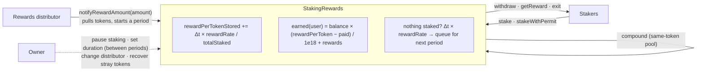

# ERC-20 Staking Rewards

An ERC-20 token plus a staking contract. Holders lock tokens and earn a reward token, streamed second by second over a reward period in proportion to their share of the pool. The repo ships unit, fuzz and invariant tests, 100% line coverage, a mutation check, and a gas report measured against the textbook implementation.

Most staking contracts copy the Synthetix `StakingRewards` design. It is cheap and elegant, but it has known flaws. Rewards that stream while nobody is staked are lost for good. Its solvency check ignores rewards that are earned but not yet claimed, so the owner can promise more than the contract holds. The reward rate is rounded to a whole number per second, which wipes out small rewards and reward tokens with few decimals. Fee-on-transfer tokens break its accounting. This contract keeps the same O(1) reward-per-token accumulator and fixes each of those flaws. Rewards are pulled in at the moment they are scheduled, so the pool can never over-promise. Idle-time rewards are queued for the next period. The rate is kept at 1e18 precision. Deposits are credited by balance difference. Withdrawals and claims stay open while the pool is paused. It still uses **14–42% less gas** than the textbook version on every staker action, thanks to its storage layout.


*`npm run demo` replays a week of staking on an in-process chain: two stakers, 70,000 RWD over 7 days. Each payout is checked against the exact answer worked out by hand; both are short by a few thousand wei (less than 0.00000000000001 RWD) of rounding dust, which stays in the pool. Below that, `npm run coverage` over all 80 tests. The image is rendered from a real run by `scripts/make-screenshot.mjs`.*

## How it works



**The accumulator.** `rewardPerToken` is the total reward one staked base unit would have earned since the pool started. Every state-changing call first brings it up to date: `+= elapsed × rewardRate / totalStaked`. It then settles the caller: `balance × (rewardPerToken − rewardPerTokenPaid)`. Each call costs the same no matter how many stakers there are.

**Funding a period.** The distributor calls `notifyRewardAmount(amount)`. The pool pulls `amount` and schedules what actually arrived, plus anything left of the running period and anything queued, evenly over `rewardsDuration`:

```
rate = (received × 1e18 + leftover + queued) / duration      // tokens per second × 1e18
```

### What changed from the Synthetix design

| Problem in the textbook contract | What this contract does | Proof |
| --- | --- | --- |
| Owner sends rewards in, then calls `notify`; the check `rate ≤ balance / duration` ignores unclaimed rewards, so it can promise more than it holds | `notifyRewardAmount` pulls the tokens itself and schedules only what arrived, so every scheduled reward is already in the contract | `invariant_poolIsSolvent`, `invariant_rewardsAreConserved` |
| Rewards that stream while `totalSupply == 0` are stranded forever | That time is added to a queue that the next `notify` rolls into the new period; `queuedRewards()` shows it | `test_notify_queuesRewards*`, `testFuzz_idleRewardsAreQueuedNotLost` |
| `rewardRate = reward / duration` truncates: 1 USDC over a year gives a rate of 0 | Rate stored × 1e18; the same reward pays out 0.999 USDC | `test_rewards_lowDecimalRewardTokenIsNotTruncated` vs `test_rewards_baselineTruncatesLowDecimalReward` |
| Credits the requested amount, so fee-on-transfer tokens make the pool insolvent | Credits the balance difference, for both stakes and rewards | `test_stake_creditsAmountReceivedForFeeOnTransferToken`, `test_notify_schedulesOnlyWhatArrived` |
| Pausing blocks everything | Pause stops `stake`, `stakeWithPermit` and `compound` only; `withdraw`, `getReward`, `exit` always work | `test_exitPaths_stayOpenWhilePaused` (and a mutant that adds the pause check to withdraw is caught) |
| Approve + stake are two transactions | `stakeWithPermit` (EIP-2612). The permit is wrapped in try/catch, so someone front-running the signature can't block the stake | `test_stakeWithPermit_survivesFrontRunPermit` |
| Staking token can't also be the reward token safely | Stake and rewards are accounted for separately, so one token can play both roles, and `compound()` restakes rewards without moving any tokens | `SameTokenPoolInvariants`, `test_compound_restakesRewards` |

The owner cannot touch staked tokens or reward tokens. `recoverERC20` refuses both, and there's a mutant for that too. The token, `StakeToken`, has a fixed supply and no owner: it mints its whole supply once in the constructor, and supports EIP-2612 permit.

### Storage layout

```solidity
uint192 rewardPerTokenStored; uint64 lastUpdateTime;                              // slot A: read + written by every call
uint128 totalStaked; uint64 periodFinish; uint32 rewardsDuration; bool paused;    // slot B: read by every call
uint256 rewardRate;                                                               // slot C
struct Account { uint128 balance; uint128 rewards; uint256 rewardPerTokenPaid; }  // 2 slots per staker
```

A staker's call touches 3 pool slots. The baseline touches 7: five variables, OpenZeppelin's `Pausable` flag and `ReentrancyGuard`'s lock. The reentrancy lock lives in transient storage (`ReentrancyGuardTransient`, EIP-1153), so it costs no storage writes. The sizes are safe: amounts are capped at 2^128 (SafeCast reverts above that). Overflowing `uint192` would take more than ~6.2e39 base units of rewards paid to a single base unit of stake over the pool's lifetime.

**Rounding** always goes in the pool's favour. A staker can be short by at most 1 base unit per settlement, plus `totalStaked / 1e18` base units per checkpoint. The fuzz tests assert that exact bound and also assert that no one is ever overpaid.

## Gas

Full report: [docs/gas-report.md](docs/gas-report.md). It's generated by `npm run gas:report`, and CI fails if it's out of date. Each figure is the `gasUsed` of a mined transaction. The same scenario runs against [contracts/benchmark/BaselineStakingRewards.sol](contracts/benchmark/BaselineStakingRewards.sol), a textbook Synthetix-style contract kept only for comparison.

| Operation | StakingRewards | Baseline | Difference |
| --- | ---: | ---: | ---: |
| stake: new staker, rewards running | 102,347 | 130,021 | -21.3% |
| stake: top-up | 85,740 | 115,721 | -25.9% |
| withdraw: partial | 63,807 | 94,036 | -32.1% |
| getReward | 77,499 | 83,002 | -6.6% |
| exit | 76,184 | 95,818 | -20.5% |
| notifyRewardAmount: mid-period top-up | 68,459 | 118,034 | -42.0% |
| stakeWithPermit: new staker | 134,032 | n/a | |
| deploy (one-off) | 2,100,107 | 974,192 | +115.6% |

Deployment costs twice as much. The pool has more functions, and `runs: 10000` trades bytecode size for cheaper calls. The runtime bytecode is 9,177 bytes, under the 24,576-byte limit. A TypeScript test fails the build if the common calls go over their gas budgets.

## Tests

| Suite | What it covers | Count |
| --- | --- | ---: |
| [StakingRewards.t.sol](test/solidity/StakingRewards.t.sol) | Every function, revert and event; reward math with exact expected values; permit flows; fee-on-transfer, reentrant-hook and 6-decimal tokens; same-token pool; the baseline's truncation bug | 55 |
| [StakingRewards.fuzz.t.sol](test/solidity/StakingRewards.fuzz.t.sol) | Payouts against exact rational answers within the proven rounding bound: single staker, split by share, late joiner, mid-period rollover, idle queue, exact principal back (1,000 runs each) | 6 |
| [StakingRewards.invariant.t.sol](test/solidity/StakingRewards.invariant.t.sol) | Random sequences of stake / withdraw / claim / exit / compound / notify / time jumps by 5 actors, on a two-token pool and a same-token pool (256 runs × 64 calls). Invariants: `totalStaked == Σ balances`; the pool can pay every exit; funded = paid + compounded + claimable + streaming + queued, with any gap inside the rounding bound | 6 |
| [StakeToken.t.sol](test/solidity/StakeToken.t.sol) | Supply, permit (incl. replay and expiry), transfer fuzz | 6 |
| [staking.test.ts](test/ts/staking.test.ts) | End to end through viem: deployment, the week scenario, a **wallet-signed** EIP-2612 permit, custom errors, pause, gas budgets | 7 |

```
npm run coverage   →  79 passing (73 solidity, 6 nodejs), 1 skipped (the gas-budget test)
                      contracts/StakingRewards.sol  100% lines  100% statements
                      contracts/StakeToken.sol      100% lines  100% statements
```

The gas-budget test is skipped under coverage because instrumentation inflates gas. It runs in `npm test`, for 80 passing in total. Hardhat 3's coverage reports lines and statements but not branches. Every `revert` and `if` in the contract has a test of its own, and the mutation check confirms that the important ones matter:

```
$ npm run mutation
killed    lose-idle-rewards               5 failing  (rewards streamed while nothing is staked are dropped)
killed    overpay-0.1%                   13 failing  (each settlement credits 0.1% too much)
killed    drop-leftover-on-notify         4 failing  (a mid-period notify forgets what was left of the current period)
killed    credit-requested-amount         1 failing  (stake credits the requested amount instead of what arrived)
killed    compound-skips-total            4 failing  (compound raises the user's balance but not totalStaked)
killed    withdraw-while-paused-blocked   1 failing  (withdraw gets the pause check, trapping funds)
killed    no-reentrancy-guard-on-stake    1 failing  (stake loses its reentrancy guard)
killed    recover-staking-token           1 failing  (the owner can sweep staked tokens)
killed    duration-change-mid-period      1 failing  (the duration can be changed while a period runs)

all mutants killed
```

## Tech stack

- **Solidity 0.8.30** (optimizer 10,000 runs, EVM target `cancun`), **OpenZeppelin Contracts 5.6**: ERC20, ERC20Permit, Ownable2Step, SafeERC20, SafeCast, ReentrancyGuardTransient
- **Hardhat 3** with the EDR runtime: Solidity tests with **forge-std** cheatcodes, fuzzing and invariant testing; built-in coverage and gas statistics
- **viem** + `node:test` for the TypeScript tests and scripts (`@nomicfoundation/hardhat-viem`, `hardhat-viem-assertions`, `hardhat-network-helpers`)
- Docker Compose for a local chain plus deployment; GitHub Actions for CI

## Setup and run

Requires Node 22.10 or newer.

```bash
npm ci
npm test               # 73 Solidity tests (unit, fuzz, invariant) + 7 TypeScript tests
npm run coverage       # same, with coverage; HTML report in coverage/html
npm run demo           # the week-of-staking scenario from the screenshot
npm run gas            # Hardhat's per-function gas table for the TypeScript tests
npm run gas:report     # regenerate docs/gas-report.md
npm run mutation       # plant 9 bugs one at a time and check the tests catch each
npm run typecheck
```

None of these need an RPC endpoint, keys or a `.env`. They run on Hardhat's in-process chain.

**Local chain plus deployment, with Docker:**

```bash
docker compose up            # chain on http://localhost:8545, then deploys and funds a 70,000 RWD period
cat deployments/31337.json   # addresses
docker compose run --rm chain npm test
```

**Without Docker:**

```bash
cp .env.example .env         # optional: duration, initial reward, same-token pool, existing tokens
npm run node                 # terminal 1: JSON-RPC node on :8545 with 20 funded accounts
npm run deploy:local         # terminal 2
```

**Sepolia:** set `SEPOLIA_RPC_URL` and `SEPOLIA_PRIVATE_KEY` (a throwaway key) in `.env`, then run `npx hardhat run scripts/deploy.ts --network sepolia`. Set `STAKING_TOKEN` / `REWARDS_TOKEN` to stake existing tokens instead of deploying fresh ones.

## Layout

```
contracts/
  StakingRewards.sol          the pool
  StakeToken.sol              fixed-supply ERC-20 + permit
  benchmark/                  textbook baseline, for the gas comparison only
  mocks/                      fee-on-transfer, reentrant-hook and mintable test tokens
test/solidity/                unit, fuzz and invariant tests (forge-std)
test/ts/                      end-to-end tests (viem + node:test)
scripts/
  lib/staking.ts              deploy + permit helpers shared by scripts and tests
  deploy.ts  demo.ts  gas-report.ts  mutation-check.mjs  make-screenshot.mjs
docs/                         gas-report.md, screenshot.svg
```

## Limitations

- **Not audited.** Static analysis (Slither, Aderyn) was not run, and neither tool is installed on the machine this was built on. Treat the contract as a portfolio piece until it has had an independent review.
- **Never deployed to a public network.** The deploy script has been run against a local `hardhat node` over JSON-RPC (two-token and same-token pools), but not against Sepolia.
- **Docker and CI are untested.** `Dockerfile`, `compose.yaml` and `.github/workflows/ci.yml` were written without Docker or a GitHub Actions run available.
- **Rebasing tokens are not supported.** Balance-difference crediting handles fee-on-transfer tokens, but not balances that change by themselves (stETH-style). Tokens that block transfers to certain addresses can lock users in.
- **Trusted roles.** The owner can pause new stakes, change the distributor, and change the duration between periods. The distributor decides when and how much to fund. Neither can move staked funds or scheduled rewards.
- **Rounding dust** (a few thousand wei per period in the demo) stays in the pool for good. No sweep function exists, because one would need a global "owed" counter and an extra storage write on every call.
- **Coverage has no branch metric** in Hardhat 3. The 100% figure is lines and statements.
- `npm audit` reports a zod advisory (GHSA-mrhx-c7xc-m3w5) inside Hardhat's own config validation. It's dev tooling only and nothing deployed is affected. The fix requires an upstream Hardhat release.
- If a sandbox or virus scanner blocks file renames inside the project (Hardhat moves build info from `cache/` to `artifacts/`), set `HARDHAT_OUT_DIR` to a folder elsewhere. That was needed on the machine this was built on.

## batch insert

Updated implementation details.

## mask pii

Updated implementation details.

## process data

Updated implementation details.

## batch insert

Updated implementation details.

## mask pii

Updated implementation details.